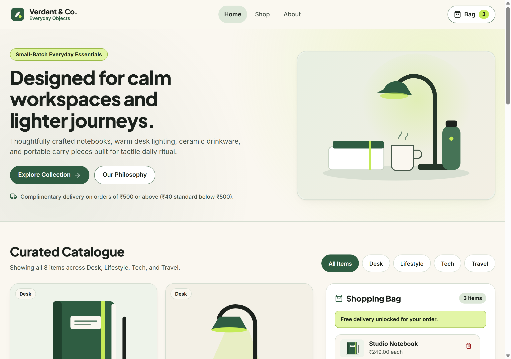
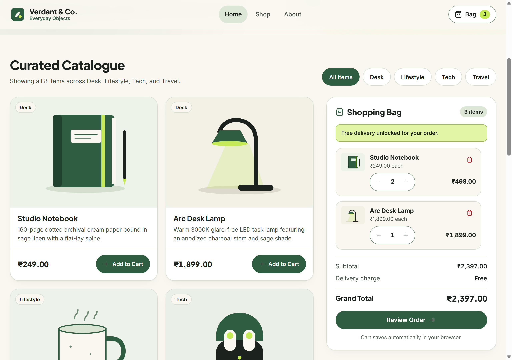
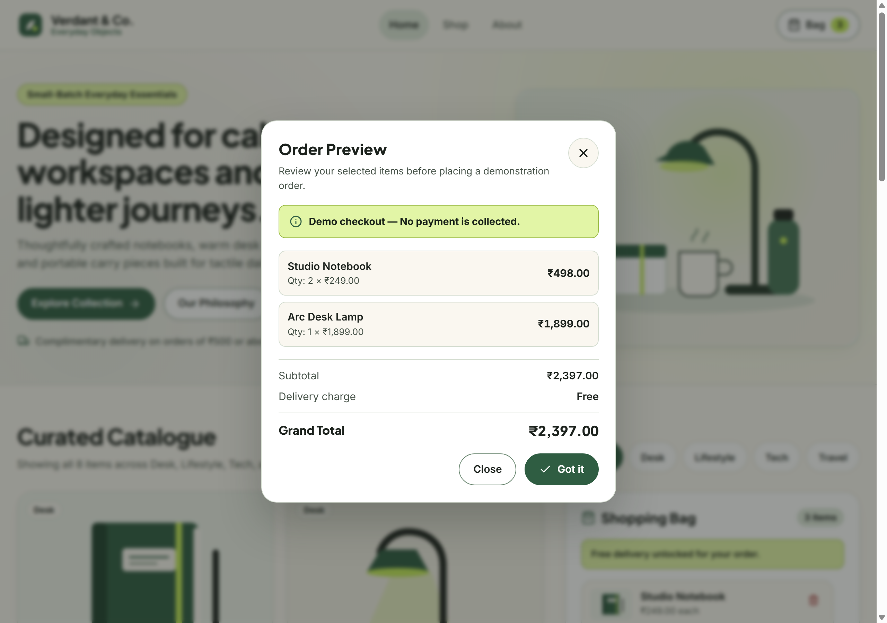
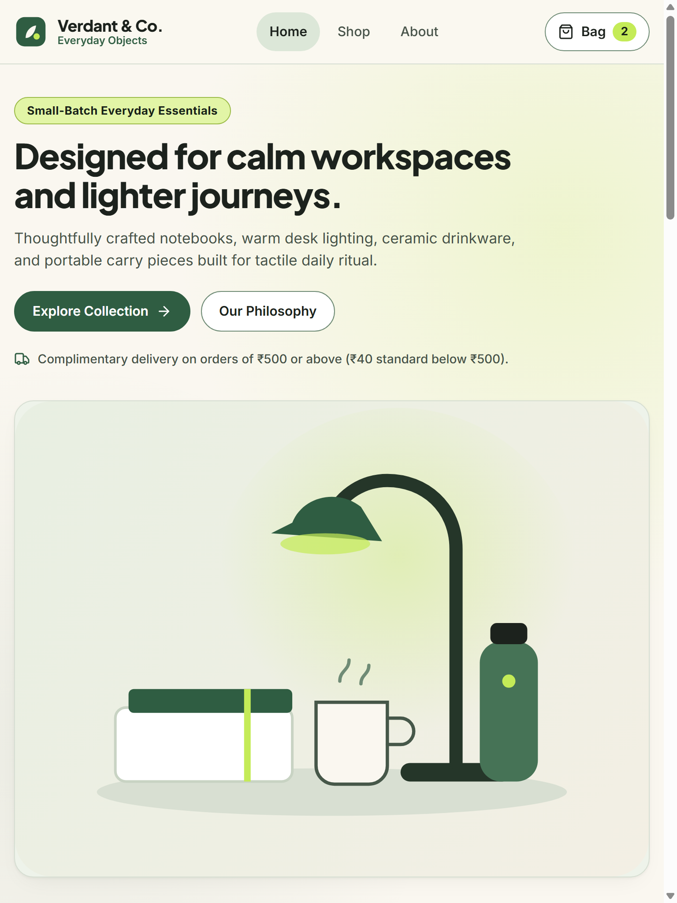
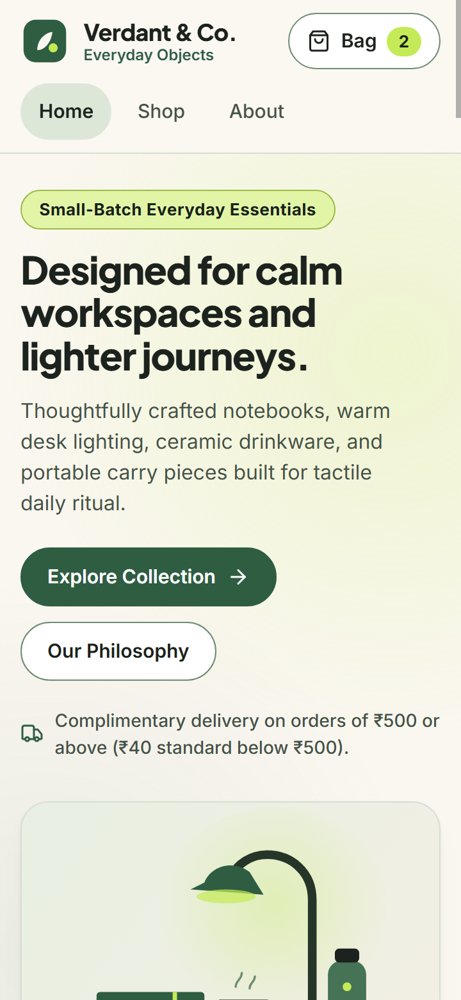
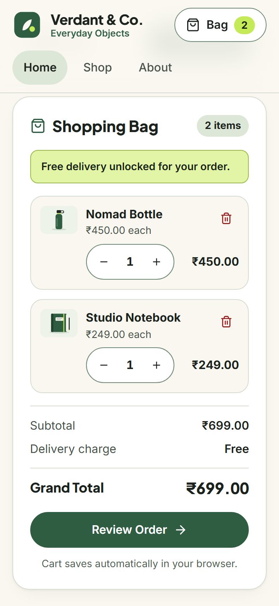

# Verdant & Co. — Interactive Mini E-Commerce Web Application

> **InternCircle Full-Stack Web Development Internship · Project 05**

A responsive, accessible minimalist lifestyle e-commerce storefront built strictly with **HTML5**, **CSS3**, and **Vanilla JavaScript (ES6+)**—featuring dynamic catalogue generation, category filtering, a live INR shopping bag with tiered delivery rules, `localStorage` persistence, and a demonstration checkout preview dialog with **zero real payment collection**.

---

## Previews

### Desktop Storefront & Populated Bag (`1280×900`)


### Curated Catalogue & Sticky Shopping Bag (`1280×900`)


### Checkout Preview Modal (`<dialog closedby="any">`)


### Tablet (`768×1024`) & Mobile (`360×780`) Views
| Tablet Storefront | Mobile Storefront | Mobile Shopping Bag |
| :---: | :---: | :---: |
|  |  |  |

---

## Project Overview

**Verdant & Co.** showcases eight curated workspace, lifestyle, tech, and travel objects styled in a warm ivory canvas (`#faf7f0`), dark charcoal ink (`#1c221d`), soft sage green (`#2f5d42`), and crisp lime (`#c4eb57`) palette. All product cards, cart line items, badge counters, and order summary totals are rendered dynamically through DOM manipulation (`document.createElement` and `textContent`) with no frontend frameworks or external build step required.

---

## Application Features

- **Dynamic Product Catalogue:** All 8 product cards are generated from the `PRODUCTS` JavaScript array in `js/script.js` (zero hardcoded product cards in `index.html`).
- **Category Filtering:** Instant filtering across `All Items`, `Desk`, `Lifestyle`, `Tech`, and `Travel` using `Array.prototype.filter()` with accessible `aria-pressed` states and live item counts.
- **Interactive Shopping Bag:**
  - `Add to Cart` adds new items or increments quantities when clicked repeatedly.
  - Per-item quantity stepper (`-` / `+`) adjusts quantities live; decreasing quantity to `0` automatically removes the product.
  - Dedicated trash button removes any line item immediately.
  - Empty bag state disables the **Review Order** button cleanly until items are added.
- **Tiered Delivery Calculation (INR):**
  - Subtotal below `₹500.00`: flat `₹40.00` standard delivery charge.
  - Subtotal `₹500.00` or above: **Free** delivery (`₹0`), with live unlock progress banner.
  - Empty cart: `₹0.00` delivery and `₹0.00` grand total.
- **Browser Persistence (`localStorage`):** Saved under key `verdant_store_cart_v1`, restoring valid cart quantities automatically across page reloads and safely discarding malformed JSON or unknown product IDs.
- **Demo Order Preview Dialog:** Native `<dialog id="checkout-modal" closedby="any">` opened with `.showModal()` displaying item breakdown, unit pricing, subtotal, delivery fee, grand total, and the explicit notice: **"Demo checkout — No payment is collected."**
- **Top-Layer Toast & Screen Reader Feedback:** Non-blocking `popover="manual"` status toasts paired with `document.ariaNotify()` / polite ARIA live region announcements (automatically suppressed while the modal dialog is open).
- **Responsive & Accessible Engineering:** CSS Grid with Subgrid row alignment across cards, `>= 44×44 CSS px` interactive touch targets, full keyboard navigation, `prefers-reduced-motion` gating, and `forced-colors` high-contrast fallbacks.

---

## Technologies Used

- **HTML5:** Semantic landmarks (`<header>`, `<nav>`, `<main>`, `<aside>`, `<footer>`), skip link, native `<dialog>`, inline SVG sprite (`<symbol>` + `<use>`).
- **CSS3:** Custom properties, CSS Grid & `subgrid`, Flexbox, dynamic viewport units (`dvh`/`dvw`), `@starting-style`, `transition-behavior: allow-discrete`, `overscroll-behavior: contain`, responsive breakpoints.
- **Vanilla JavaScript (ES6+):** Strict mode, `Array.prototype.map()`, `.filter()`, `.find()`, and `.reduce()`, `Intl` INR formatting (`toLocaleString("en-IN", { style: "currency", currency: "INR" })`), `localStorage`, event delegation, and XSS-safe DOM creation.
- **Typography & Icons:** Google Fonts (`Plus Jakarta Sans` & `Inter`) + lightweight inline Lucide-compatible SVG icons.
- **Custom Vector Illustrations:** Hand-crafted SVG product artwork in `assets/images/`.

---

## Product Catalogue

| # | Product Name | ID | Category | Unit Price (INR) | Description |
| :-: | :--- | :--- | :--- | :---: | :--- |
| 1 | **Studio Notebook** | `studio-notebook` | Desk | `₹249.00` | 160-page dotted archival cream paper bound in sage linen with a flat-lay spine. |
| 2 | **Arc Desk Lamp** | `arc-desk-lamp` | Desk | `₹1,899.00` | Warm 3000K glare-free LED task lamp featuring an anodized charcoal stem and sage shade. |
| 3 | **Cloud Ceramic Mug** | `cloud-ceramic-mug` | Lifestyle | `₹349.00` | Hand-glazed speckled stoneware mug built for slow pour-over mornings (320 ml). |
| 4 | **Pulse Wireless Buds** | `pulse-wireless-buds` | Tech | `₹2,499.00` | Compact ergonomic earbuds delivering crisp acoustics and 28-hour pocket charging. |
| 5 | **Everyday Tote** | `everyday-tote` | Lifestyle | `₹649.00` | Heavyweight 16 oz organic canvas carryall with wide cotton straps and slip organizer. |
| 6 | **Orbit Power Bank** | `orbit-power-bank` | Tech | `₹1,499.00` | 10,000 mAh pocket-slim aluminum fast charger with dual USB-C ports and charge indicators. |
| 7 | **Nomad Bottle** | `nomad-bottle` | Travel | `₹450.00` | Double-wall vacuum insulated stainless flask keeping drinks chilled for 24 hours (650 ml). |
| 8 | **Weekender Pouch** | `weekender-pouch` | Travel | `₹899.00` | Water-resistant ballistic weave organizer keeping cables, passports, and adapters tidy. |

---

## Core JavaScript Architecture (`js/script.js`)

| Function | Responsibility |
| :--- | :--- |
| `addToCart(id)` | Looks up the product via `PRODUCTS.find()`, increments cart quantity, persists, re-renders bag, and announces feedback. |
| `changeQuantity(id, delta)` | Increments or decrements product quantity; removes the key cleanly when quantity drops to `<= 0`. |
| `removeItem(id)` | Deletes the selected item directly from the cart state, persists changes, and updates UI totals. |
| `calculateTotals()` | Uses `.map()`, `.filter()`, `.find()`, and `.reduce()` to compute `lineEntries`, `itemCount`, `subtotal`, `deliveryFee`, and `grandTotal`. |
| `renderProducts()` | Filters `PRODUCTS` by `activeCategory` and builds `.product-card` nodes programmatically. |
| `renderCart()` | Updates nav badge (`#nav-cart-count`), cart item rows, quantity steppers, delivery threshold status banner, totals, and Checkout button state. |
| `saveCart()` | Safely serializes `cart` into `localStorage` under `verdant_store_cart_v1`. |
| `loadCart()` | Reads `localStorage`, validates JSON structure, checks each ID against `PRODUCTS.find()`, enforces positive integer bounds (`1..999`), and falls back safely on malformed input. |
| `openCheckoutPreview()` | Populates and opens `<dialog id="checkout-modal">` via `.showModal()` with live summary and non-payment notice. |

### Price & Delivery Calculation Example

1. **Below Free Threshold (`1 × Studio Notebook`)**:
   - Subtotal = `₹249.00` (`< ₹500`)
   - Delivery charge = `₹40.00`
   - **Grand Total = `₹289.00`**
2. **Threshold Unlocked (`1 × Studio Notebook + 1 × Cloud Ceramic Mug`)**:
   - Subtotal = `₹249.00 + ₹349.00 = ₹598.00` (`>= ₹500`)
   - Delivery charge = `Free` (`₹0`)
   - **Grand Total = `₹598.00`**

---

## Folder Structure

```text
Task5/
├── .gitignore
├── README.md
├── index.html
├── css/
│   └── style.css
├── js/
│   └── script.js
└── assets/
    ├── images/
    │   ├── brand-logo.svg
    │   ├── hero-collection.svg
    │   ├── product-1-notebook.svg
    │   ├── product-2-lamp.svg
    │   ├── product-3-mug.svg
    │   ├── product-4-buds.svg
    │   ├── product-5-tote.svg
    │   ├── product-6-powerbank.svg
    │   ├── product-7-bottle.svg
    │   └── product-8-pouch.svg
    └── screenshots/
        ├── storefront-desktop.png
        ├── catalogue-desktop.png
        ├── checkout-modal.png
        ├── storefront-tablet.png
        ├── storefront-mobile.png
        └── cart-mobile.png
```

---

## How to Run Locally

Because the application is 100% static with zero build dependencies, open `Task5` with any local HTTP server (or open `index.html` directly, though serving over HTTP is recommended for crisp asset resolution):

### Option 1 — VS Code Live Server
1. Open the `Task5` folder in VS Code.
2. Right-click `index.html` and select **Open with Live Server**.

### Option 2 — Node.js (`npx serve`)
```bash
cd Task5
npx serve .
```

### Option 3 — Python Built-in Server
```bash
cd Task5
python -m http.server 5500
```

---

## Verification Checklist (All 19 Scenarios Verified)

Verified via automated headless Chrome CDP tests (`1280×900`, `768×1024`, `360×780`) with **0 console errors**, **0 uncaught exceptions**, **0 horizontal overflow**, and **all interactive targets ≥ 44 px**:

- [x] All 8 products display on initial load (`Studio Notebook` through `Weekender Pouch`).
- [x] Catalogue cards render strictly from JS `PRODUCTS` array (zero hardcoded cards in HTML).
- [x] Adding a single item updates navigation badge, bag list, and totals.
- [x] Adding the same product multiple times increments quantity without duplicating rows.
- [x] Adding different products tracks independent quantities and line totals accurately.
- [x] Quantity `+` increments count and totals live.
- [x] Quantity `-` decrements count and totals live.
- [x] Decreasing quantity from `1` to `0` removes the item from the bag.
- [x] Remove (`trash`) button removes item completely.
- [x] Removing the final item renders `"Your bag is empty"`, resets totals to `₹0.00`, and disables **Review Order**.
- [x] Subtotal accurately aggregates `price × quantity` across items via `.reduce()`.
- [x] `₹40.00` delivery charge applies automatically below `₹500.00` (`₹249 + ₹40 = ₹289`).
- [x] `Free` delivery activates automatically at `₹500.00+` (`₹847.00` subtotal → `Free` delivery).
- [x] Cart persists across full page reloads via `localStorage` and recovers safely from malformed JSON / invalid IDs.
- [x] Checkout Preview `<dialog>` opens with `.showModal()` and closes via **Close**, **Got it**, `X`, `Esc`, and backdrop light-dismiss.
- [x] Checkout modal displays matching item breakdown, totals, zero payment form fields, and explicit disclaimer: *"Demo checkout — No payment is collected."*
- [x] Category filter pills (`Desk`, `Lifestyle`, `Tech`, `Travel`, `All Items`) filter correctly (`2` items per category, `8` total).
- [x] Responsive across Mobile (`360px`), Tablet (`768px`), and Desktop (`1280px`) with zero horizontal scroll overflow.
- [x] Zero console errors, warnings, or failed network requests.

---

## GitHub Pages Deployment

1. Push the `Task5` directory contents to a standalone GitHub repository.
2. Navigate to **Settings → Pages** in your GitHub repository.
3. Under **Build and deployment**, select **Deploy from a branch**.
4. Choose `main` and `/ (root)`, then click **Save**.
5. Because all stylesheet, script, and image paths use relative URLs (`./css/style.css`, `./js/script.js`, `./assets/images/...`), the storefront works identically on any root or subpath GitHub Pages URL.

---

> Built for **InternCircle Full-Stack Web Development Internship — Project 05**.
